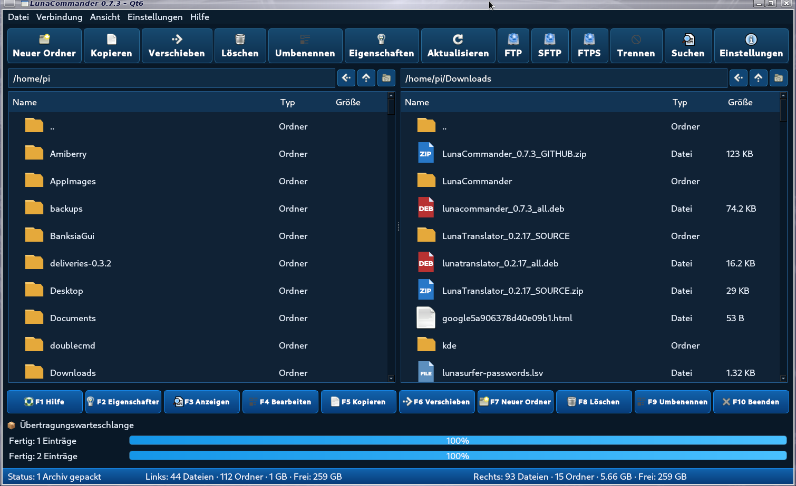

# LunaCommander 0.6.55

LunaCommander ist ein zweispaltiger Dateimanager auf Basis von Python und Qt 6. Zielsystem ist Debian 13 (Trixie) beziehungsweise Raspberry Pi OS auf ARM64. Das Programm kann auch auf anderen Debian-basierten Linux-Systemen mit den genannten Abhängigkeiten laufen.



[Github Seite](https://github.com/Angonikro/LunaCommander/)

## Funktionen

- Zwei Dateifenster mit unabhängiger Navigation und eigener Zurück-/Vorwärts-Historie; unterstützt auch die seitlichen Maus-Back-/Forward-Tasten.
- Mehrfachauswahl mit **STRG + Linksklick** und **SHIFT + Linksklick**.
- Markierte lokale Dateien und Ordner lassen sich per gedrückter linker Maustaste aus dem Dateifenster in den Desktop oder andere Dateimanager ziehen; mehrere ausgewählte Einträge werden gemeinsam als Datei-URLs übergeben.
- Dateien und Ordner erstellen, kopieren, verschieben, löschen, umbenennen und deren Eigenschaften anzeigen.
- FTP-, FTPS- und SFTP-Verbindungen.
- Archive erstellen: ZIP, RAR, 7z, TAR, TAR.GZ, TAR.XZ und TAR.BZ2; unterstützte Archive lassen sich im Dateifenster durchsuchen.
- Dateityp-Symbole für Audio, Video, Bilder, PDF, Dokumente, Tabellen, Präsentationen, Datenträger-Images, Quellcode, Untertitel, Pakete und Torrents.
- Optionale Bild-Miniaturen direkt in der Dateiliste; Hintergrundverarbeitung hält die Oberfläche bedienbar.
- Kontextmenü **Öffnen mit**: LunaCommander schlägt passende installierte Programme abhängig vom Dateityp vor (zum Beispiel VLC/MPV für Video und Audio, Bildbetrachter für Bilder, PDF-Viewer für PDF, LibreOffice für Office-Dateien und Archivmanager für Archive).
- Gewählte Programme werden pro Dateiendung gespeichert und beim nächsten Mal zuerst vorgeschlagen. Die Zuordnung bleibt in `~/.config/lunacommander/settings.json` und ändert nicht die systemweiten Dateizuordnungen.
- Weitere Programme können über **Andere Anwendung auswählen…** gewählt werden.
- Dunkles/helles Farbschema sowie Deutsch, Englisch, Französisch, Italienisch und Niederländisch.
- Einzel- oder Doppelklick zum Öffnen, getrennte Startordner und F1–F10-Funktionstasten.

## RAR-Hinweis

Für das Erstellen von RAR-Archiven wird das externe RARLAB-Programm `rar` benötigt. Es wird nicht automatisch installiert. Wenn `rar` vorhanden ist, wird es erkannt; andernfalls kann der Programmpfad in **Einstellungen → Archivprogramme → RAR** angegeben werden. Zum Entpacken werden die installierten Debian-Werkzeuge verwendet.

## Einstellungen und gespeicherte Öffnen-mit-Zuordnungen

Die persönlichen Einstellungen befinden sich hier:

```text
~/.config/lunacommander/settings.json
```

Dort speichert LunaCommander unter anderem Sprache, Farbschema, Klickverhalten, Startordner und die selbst gewählten **Öffnen mit**-Programme pro Dateiendung. Diese gespeicherten Zuordnungen überschreiben nicht die systemweiten Standardprogramme.

## Hilfe

Die integrierte Hilfe öffnest du mit **F1** oder über das Menü **Hilfe**. Sie ist in Deutsch, Englisch, Französisch, Italienisch und Niederländisch verfügbar.

## Voraussetzungen und Abhängigkeiten

Für Debian 13 / Raspberry Pi OS (ARM64):

```bash
sudo apt update
sudo apt install -y python3 python3-pyside6.qtwidgets python3-paramiko xdg-utils zip tar gzip xz-utils bzip2 7zip unar unrar-free
```

Optionale Programme für **Öffnen mit** werden nur angeboten, wenn sie installiert und im PATH verfügbar sind. Beispiele:

```bash
sudo apt install vlc mpv ristretto evince atril okular mousepad geany libreoffice engrampa file-roller xarchiver
```

Du musst nicht alle optionalen Programme installieren. Verwende nur die Anwendungen, die du tatsächlich benötigst.

## Installation aus dem ZIP (ohne DEB)

1. ZIP-Archiv herunterladen und entpacken.
2. Terminal im entpackten Ordner `lunacommander` öffnen.
3. Starten mit:

```bash
python3 main.py
```

Beispiel, wenn das ZIP im Download-Ordner liegt:

```bash
mkdir -p ~/Programme
unzip ~/Downloads/LunaCommander_0.6.55_GITHUB.zip -d ~/Programme
cd ~/Programme/lunacommander
python3 main.py
```

## Installation mit Debian-Paket

Im Download-Ordner ausführen:

```bash
sudo apt update
sudo apt install ./lunacommander_0.6.55_all.deb
```

Danach über das Anwendungsmenü **LunaCommander** oder im Terminal mit folgendem Befehl starten:

```bash
lunacommander
```

Das DEB installiert die Anwendung nach `/usr/share/lunacommander` und legt den Programmstarter im Anwendungsmenü an. Die Paketarchitektur ist `all`; es wird keine virtuelle Python-Umgebung angelegt und während der Installation wird kein `pip` ausgeführt.

## Projektinformationen

- Projekt: LunaCommander
- Version: 0.6.54
- Maintainer: LunaProject
- Zielplattform: Debian 13 / Raspberry Pi OS, ARM64
- Lizenz: siehe Projekt-/Quellcodehinweise im Repository.

73 de DO2QG Andreas
